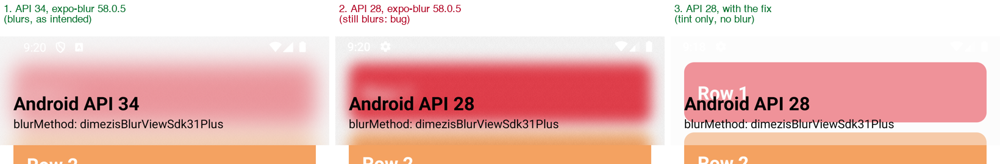

# expo-blur: a crash below Android 12, and a blur that shouldn't run there

This repo reproduces two related problems with expo-blur on SDK 58 (`expo` 58.0.17, `expo-blur` 58.0.5, `react-native` 0.88.0, `react-native-reanimated` 4.7.1), New Architecture. It belongs to [expo/expo#52042](https://github.com/expo/expo/issues/52042).

## What the app contains

`App.tsx` renders a list of colored rows inside a `BlurTargetView` and lays a frosted header over it. The header is a `BlurView` (made animatable with Reanimated) with `blurTarget` pointing at that view and `blurMethod="dimezisBlurViewSdk31Plus"`. Its height grows with the scroll, driven by `useAnimatedScrollHandler` and `useAnimatedStyle`, like a bar that grows behind controls docking under it.

According to the docs, `dimezisBlurViewSdk31Plus` uses the Dimezis blur on Android 12 (API 31) and newer and falls back to `'none'` on older versions, which renders a semi-transparent view instead of a blur.

## How to reproduce the crash

Build the app and run it on Android 11 or older (I used an API 28 emulator):

```sh
npm install
npx expo run:android --variant release
```

Fling the list up and down a few times. The app crashes:

```
java.lang.IllegalStateException: Underflow in restore - more restores than saves
    at android.graphics.Canvas.restore(Canvas.java:605)
    at eightbitlab.com.blurview.PreDrawBlurController.updateBlur(PreDrawBlurController.java:135)
    at eightbitlab.com.blurview.PreDrawBlurController$1.onPreDraw(PreDrawBlurController.java:54)
    at android.view.ViewTreeObserver.dispatchOnPreDraw(ViewTreeObserver.java:977)
    at android.view.ViewRootImpl.performTraversals(ViewRootImpl.java:2474)
```

It crashed in three out of three runs on API 28. On API 34 the same app doesn't crash.

## Why it crashes

I built the Dimezis BlurView 3.1.0 sources into the app and logged what happens inside `PreDrawBlurController.updateBlur()`. It saves the state of its internal canvas, draws the blur target into it with `rootView.draw(internalCanvas)`, and then restores the canvas. While the target draws, the `ScrollView` is still flinging, so `ScrollView.computeScroll()` runs inside `draw()` and reports a scroll. Reanimated handles that scroll event right away and applies the new header height synchronously through Fabric. The `BlurView` gets a new size, `onSizeChanged` calls `PreDrawBlurController.init()`, and `init()` replaces `internalCanvas` with a new one. When `updateBlur()` continues, it calls `restore()` on the new, fresh canvas, which has nothing saved, and that throws.

The logged call chain, shortened:

```
PreDrawBlurController.init()                    <- replaces internalCanvas
BlurView.onSizeChanged()
SurfaceMountingManager.updateLayout()           <- Fabric mount, applied synchronously
NodesManager.performOperations()                <- Reanimated
EventHandler.receiveEvent()                     <- scroll event
ScrollView.onScrollChanged() / computeScroll()
View.draw()                                     <- the blur target, drawn from updateBlur()
```

So the crash is in the Dimezis library itself: it needs to keep the canvas it saved on, or postpone re-initializing until the current `updateBlur()` has finished. The same crash happens with `blurMethod="dimezisBlurView"` on any Android version below 12. I reported it as [Dimezis/BlurView#273](https://github.com/Dimezis/BlurView/issues/273). An older report of the same crash is [Dimezis/BlurView#184](https://github.com/Dimezis/BlurView/issues/184).

## The expo-blur part

With `dimezisBlurViewSdk31Plus` the crash shouldn't happen at all below Android 12, because there should be no blur. But expo-blur turns the blur on anyway. `ExpoBlurView.setBlurTargetId` calls `configureBlurView()`, which calls `blurView.setupWith(target)` and thereby enables the Dimezis blur. Nothing re-applies the blur method afterwards, so the API 31 check in `setBlurMethod` never runs again. Radius and tint aren't re-applied either.

You can see this without the crash: below Android 12 the header blurs the rows behind it, although it should only show its tint (screens 1 to 3 below were taken with a header of fixed height).



[`fix/expo-blur.patch`](fix/expo-blur.patch) calls `applyCurrentBlurSettings()` right after `configureBlurView()` in `setBlurTargetId`, the same way `onAttachedToWindow` already does. With it, API 28 shows the tint as documented, and the app no longer crashes, because no blur runs. It does not fix the crash for `dimezisBlurView`, which is the Dimezis problem described above.

To try the patch, note that Expo modules ship a prebuilt AAR since SDK 58, so a patched source file is ignored unless the module is built from source. This repo sets that up in `package.json` (`expo.autolinking.android.buildFromSource: ["expo-blur"]`):

```sh
(cd node_modules/expo-blur && patch -p1 < ../../fix/expo-blur.patch)
npx expo run:android --variant release
```
